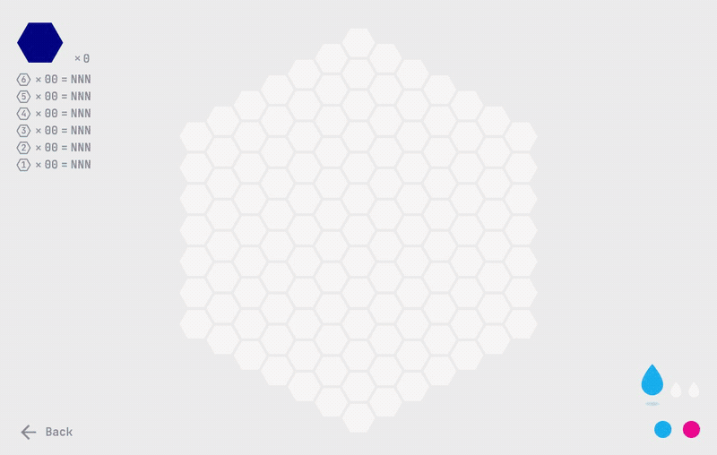

# INK on HEX

シアン、マゼンタ、イエロー。六角形の盤面にインクを垂らし、広がる色を重ねて課題色を作るブラウザパズルです。

## 遊び方

パレットからインクを選び、盤面のセルをクリックまたはタップします。インクは落としたセルから周囲へ `6 → 5 → 4 → 3 → 2 → 1` の量で広がります。盤面の欠けは越えず、セルに入る量は合計6まで。インクで満たされたセルは、配合に応じて色が決まります。

たとえば、シアン3とマゼンタ3が重なるとBlueになります。インクを落とす位置や、色を重ねる順番で盤面は変わります。

- **ミッション**　決められたインクと手数で、課題色をそれぞれ1セル以上作るとCLEAR。クリア時の最終スコアは「課題色のセル数 × 盤面全体のインク量」です。ベストスコアを出した手順は、トロフィーから再生できます。
- **アトリエ**　手数を気にせず、3色のインクを自由に試せます。Undo／Redoで手を行き来できます。
- **コレクション**　クリアしたミッションで作った色と回数を記録します。まだ作っていない混色は「?」で表示されます。

ベストスコアとコレクションは、遊んだブラウザに保存されます。

## ステージメーカー

ミッションを作る外部ツールです。`bun run maker` で起動します。盤面の形、使えるインク、手数、課題色を決めて試しに遊べます。ランダムな試行でクリア率を調べ、ミッション定義を書き出せます。

## 開発

TypeScript・React・Viteで構成し、盤面の描画にはthree.js（WebGL）、演出にはGSAPを使っています。スタイルはCSS Modules（SCSS）、状態管理はjotai、フォントはJetBrains Monoです。記録はブラウザのlocalStorageに保存し、ゲームはVercelで配信します。ルールと技術構成の詳細は[ゲーム仕様](./_llm-docs/spec/index.md)にまとめています。

| コマンド                  | 用途                                                   |
| ------------------------- | ------------------------------------------------------ |
| `bun install`             | 依存関係をインストール                                 |
| `bun run dev`             | ゲームの開発サーバーを起動                             |
| `bun run build`           | ゲーム本編のみを `dist/` にビルド                      |
| `bun run storybook`       | UI部品のカタログを起動                                 |
| `bun run build-storybook` | UI部品のカタログを `storybook-static/` にビルド        |
| `bun run test`            | ゲームルールのテスト                                   |
| `bun run test:e2e`        | ブラウザテスト。スクリーンショットは `e2e/out/` に出力 |
| `bun run test:hooks`      | Claude Codeフックのテスト                              |
| `bun run typecheck`       | 型チェック                                             |
| `bun run lint`            | lint                                                   |
| `bun run format`          | コードとMarkdownの整形                                 |

ブラウザテストを初めて動かすときは、`bunx playwright install chromium` でChromiumを用意します。
